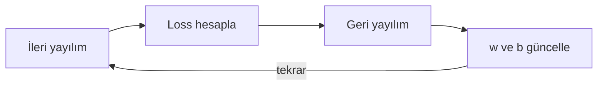

# Derin Öğrenme Kavramı

#derin-öğrenme #temel-kavramlar

1. [[#Derin Öğrenme Nedir?]]
2. [[#Derin Öğrenme Nasıl Çalışır?]]
3. [[#Derin Öğrenme Ağının Bileşenleri]]
4. [[#Derin Öğrenme Nasıl Öğrenir?]]
5. [[#Derin Öğrenmenin Zorlukları]]
6. [[#Derin Öğrenme Yöntemleri]]

---

## Derin Öğrenme Nedir?
Makine öğrenmesinin bir alt dalıdır. **Çok katmanlı yapay sinir ağları** ile veriden **kendi kendine** öğrenir. "Derin" = **çok sayıda gizli katman**.

> Yapay Zekâ ⊃ Makine Öğrenmesi ⊃ Derin Öğrenme

| | Klasik ML | Derin Öğrenme |
|---|---|---|
| Özellik çıkarımı | İnsan elle yapar | Ağ kendisi öğrenir |
| Veri ihtiyacı | Az–orta | Çok |
| Donanım | CPU | GPU |
| Görüntü, ses, metin | Zayıf | Çok güçlü |

**Neden son yıllarda yükseldi?** Büyük veri + GPU gücü + yeni algoritmalar (ReLU, Dropout, Adam…)

---

## Derin Öğrenme Nasıl Çalışır?
Veri **katman katman** ilerler. Her katman bir öncekinden **daha soyut** bir özellik çıkarır:

> Yüz tanıma: kenar, çizgi → göz, burun → yüzün tamamı

Bu özellikleri kimse elle tanımlamaz, **ağ kendisi keşfeder**.

**Bir nöron ne yapar?** Girdileri ağırlıklarla çarpar, toplar, bias ekler ve aktivasyondan geçirir:

$$
y = f(xw + b)
$$

**Aktivasyon fonksiyonu ($f$) neden var?** Olmasaydı her katman doğrusal olurdu ve 100 katman 1 katmandan farksız olurdu. Aktivasyon ağa **karmaşık (eğri) ilişkileri** öğrenme gücü verir.

| Fonksiyon | Çıktı | Nerede? |
|---|---|---|
| **ReLU** $\max(0,x)$ | $[0, \infty)$ | Gizli katmanlar (en yaygın) |
| **Sigmoid** | $(0, 1)$ | İkili sınıflandırma çıktısı |
| **Tanh** | $(-1, 1)$ | Gizli katmanlar |
| **Softmax** | Olasılıklar (toplam 1) | Çok sınıflı çıktı |

---

## Derin Öğrenme Ağının Bileşenleri

![[Derin Öğrenme Ağının Bileşenleri.png]]

- **Girdi katmanı:** Veriyi ağa verir. Nöron sayısı = özellik sayısı (örneğin metrekare, oda sayısı, bina yaşı → 3 nöron).
- **Gizli katmanlar:** Öğrenmenin yapıldığı yer. Sayısı arttıkça ağ **derinleşir**.
- **Çıktı katmanı:** Tahmini verir. Regresyon → 1 nöron, çok sınıflı sınıflandırma → sınıf sayısı kadar nöron.
- **Ağırlık ($w$) ve bias ($b$):** Her okun bir ağırlığı vardır. Ağın öğrendiği şey bu değerlerdir (**parametreler**).

> **Parametre sayısı (3 → 4 → 4 → 1):** $(3\cdot4+4) + (4\cdot4+4) + (4\cdot1+1) = 16 + 20 + 5 = $ **41**

---

## Derin Öğrenme Nasıl Öğrenir?
> **Cevap:** Parametrelerin ($w$, $b$) **gradient descent** ile güncellenmesiyle.

**1) İleri yayılım (Forward):** Veri soldan sağa akar, tahmin ($y'$) üretilir. Her katmanın çıktısı sonrakinin girdisidir:

$xw+b = h_1 \;\rightarrow\; f(h_1) = z_1 \;\rightarrow\; z_1w+b = h_2 \;\rightarrow\; f(h_2)=z_2 \;\rightarrow\; \dots \;\rightarrow\; y'$

**2) Loss:** Tahmin ile gerçek arasındaki fark. **Hata = loss.** Örnek: $L = (y - y')^2$

**3) Geri yayılım (Backward):** Hata sağdan sola geri gönderilir. **Zincir kuralı** ile her ağırlığın hatadaki payı (gradyan, $\frac{\partial L}{\partial w}$) bulunur.

**4) Güncelleme (Gradient Descent):**
$$
w = w - \eta \frac{\partial L}{\partial w}
$$
$\eta$ = öğrenme oranı. 🏔️ Sisli dağda eğimin **tersine** küçük adımlarla vadinin dibine (en düşük hataya) inmek gibi.

### 🔢 Mini Örnek
$x=2,\; y=3,\; w=0.5,\; b=1,\; \eta=0.1$
1. Tahmin: $y' = 2 \cdot 0.5 + 1 = 2$ → Loss $= (3-2)^2 = 1$
2. Gradyanlar: $\frac{\partial L}{\partial w} = -2(y-y')x = -4$, $\;\frac{\partial L}{\partial b} = -2$
3. Güncelleme: $w = 0.5 + 0.4 = 0.9$, $\;b = 1 + 0.2 = 1.2$
4. Yeni tahmin: $2 \cdot 0.9 + 1.2 = 3$ → **Loss = 0** 🎉

**Terimler:** **Epoch** = tüm verinin ağdan bir kez geçmesi · **Batch size** = bir güncellemede kullanılan örnek sayısı

---

## Derin Öğrenmenin Zorlukları
| Zorluk | Ne demek? | Çözüm |
|---|---|---|
| **Çok veri ihtiyacı** | Milyonlarca parametre için çok etiketli veri gerekir | Veri artırma, transfer öğrenme |
| **Hesaplama maliyeti** | Güçlü GPU, uzun eğitim süresi | Bulut GPU, hazır modeller |
| **Overfitting** | Model ezberler. Eğitimde iyi, yeni veride kötü | Dropout, L2, early stopping, daha çok veri |
| **Underfitting** | Model yeterince öğrenemez | Daha büyük model, daha uzun eğitim |
| **Vanishing gradient** | Gradyan geriye giderken küçülür, ilk katmanlar öğrenemez | ReLU, Batch Norm, ResNet |
| **Kara kutu** | Modelin neden o kararı verdiği anlaşılmaz | Açıklanabilir YZ (XAI) |
| **Hiperparametre ayarı** | Doğru öğrenme oranı, katman sayısı vb. bulmak zor | Deneme-yanılma, arama yöntemleri |
| **Önyargı (bias)** | Verideki önyargı modele geçer | Dengeli, çeşitli veri |

> 📝 **Overfitting** = sınava sadece çıkmış soruları ezberleyerek giren öğrenci.

---

## Derin Öğrenme Yöntemleri
Derste işlenen yöntemlerin listesi. İşledikçe notları eklenecek.

| Yöntem | Not |
|---|---|
| Yapay Sinir Ağları (ANN) | [[Yapay Sinir Ağları (ANN)]] |
| Evrişimsel Sinir Ağları (CNN) | |
| Yinelemeli Sinir Ağları (RNN) | |
| Uzun Kısa Süreli Bellek (LSTM) | |
| Çekişmeli Üretici Ağlar (GANs) | |
| Radyal Temelli Fonksiyon Ağları (RBFNs) | |
| Kendini Düzenleyen Haritalar (SOMs) | |
| Derin İnanç Ağları (DBNs) | |
| Otomatik Kodlayıcılar (Autoencoders) | |
| Transfer Öğrenimi (Transfer Learning) | |
| Artık Ağlar (ResNets) | |
| Derin Pekiştirmeli Öğrenme | |
| Transformers | |

---
🏠 [[Giriş]] | Sonraki → [[ANN, CNN, RNN, LSTM]]
