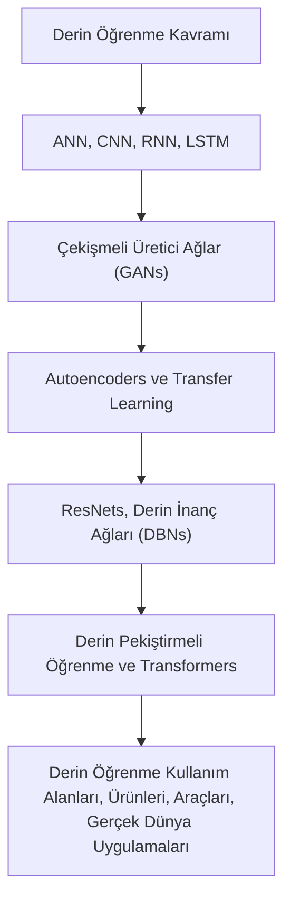

## Konular
1. [[Derin Öğrenme Kavramı]]
2. [[ANN, CNN, RNN, LSTM]]
3. [[Çekişmeli Üretici Ağlar (GANs)]]
4. [[Autoencoders ve Transfer Learning]]
5. [[ResNets, Derin İnanç Ağları (DBNs)]]
6. [[Derin Pekiştirmeli Öğrenme ve Transformers]]
7. [[Derin Öğrenme Kullanım Alanları, Ürünleri, Araçları, Gerçek Dünya Uygulamaları]]
