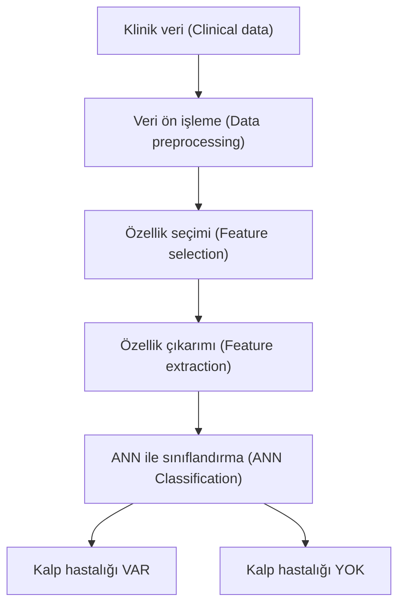

# Yapay Sinir Ağları (ANN)

#derin-öğrenme #yöntemler

## Tanım
Yapay sinir ağları (Artificial Neural Networks), **beyindeki biyolojik sinir ağlarının yapısını taklit ederek** karmaşık veri örüntülerini öğrenmeye çalışan bir makine öğrenmesi modeli.

Yapısı: **girdi katmanı → gizli katmanlar → çıktı katmanı.**

![[Architecture.webp]]

- **Kullanım alanları:** Finansal öngörüler, görüntü tanıma, dil işleme, oyun stratejileri
- **Örnek:** Sesli komutları tanıyan bir uygulama

## Öğrenme
ANN'de öğrenmek = **en iyi $w$ ve $b$ değerlerini bulmak.**

![[ANN Öğrenme (işaretli).png]]

Kırmızılar derste hocanın şema üzerinde gösterdikleri:
- **$w$:** Nöronlar arasındaki her bağlantının bir ağırlığı var.
- **$b$:** Her katmana bir bias ekleniyor. Yukarıdan gelen "adjusting the weights" okları da bu katmanlara iniyor, yani güncellenen şey bu $w$ ve $b$'ler.
- **$h_1$, $h_2$:** Gizli katmanlar. **$o$:** Çıktı katmanı.

Şemanın geri kalanını şöyle okuyorum:
- **Training data** (eğitim verisi) ikiye ayrılıyor: **inputs** ($i_0 \dots i_4$) ağa giriyor, **correct outputs** ($t_0, t_1$) yani doğru cevaplar kenarda bekliyor.
- Ağ girdileri katmanlardan geçirip **network outputs** ($O_0, O_1$) yani tahminlerini üretiyor.
- Tahminler doğru cevaplarla karşılaştırılıyor, aradaki fark **error** (hata).
- **Training algorithm** bu hataya bakıp **adjusting the weights**, yani ağırlıkları ayarlıyor. Sonra her şey tekrar ediyor.

## Hocanın kenara yazdıkları
Hoca slaytın etrafına öğrenmenin adımlarını yazıp tek tek ne olduklarını anlattı. Matematik hesaplarını ileride ayrıca göreceğimizi söyledi. Şimdilik mantığını anlamak yeterli.

Öğrenme 3 adımdan oluşuyor: **forward propagation**, **loss calculation**, **backward propagation**. Sonra ağırlıklar güncelleniyor ve bu döngü tekrar ediyor.

### 1) Forward propagation – ileri yayılım
Veri soldan sağa, girdiden çıktıya doğru ilerliyor.

Her nöronun içinde aynı şey oluyor: gelen değer ağırlıkla çarpılıyor, üstüne bias ekleniyor ($xw+b$), sonra bu sonuç bir **aktivasyon fonksiyonundan** ($f$) geçiyor. Kısaca her nöron $f(xw+b)$ hesaplıyor. Çıkan değer bir sonraki katmana gidiyor ve orada aynı işlem tekrarlanıyor.

Şemadaki isimlerle: ilk katmanda $w_1$ ile $h_1$ hesaplanıp $f_1$'den geçiyor, ikinci katmanda $w_2$ ile $h_2$ hesaplanıp $f_2$'den geçiyor, en sonda çıktı katmanında ($o$) **tahmin** çıkıyor. Hoca bu tahmine **pred** dedi ve $\hat{y}$ diye gösterdi.

**Aktivasyon fonksiyonu ne işe yarıyor?** Nöronun çıktısını şekillendiriyor. Derste adı geçen üç tane var: **ReLU**, **tanh** ve **sigmoid**.

### 2) Loss calculation – hatayı hesaplama
Ağ bir tahmin yaptı ($\hat{y}$), elimizde bir de doğru cevap var ($y$). Loss, bu ikisinin **ne kadar farklı olduğunu** ölçüyor: $L(\hat{y}, y)$

Loss'u nasıl hesaplayacağımız problemin türüne göre değişiyor:
- **Regresyon** (bir sayı tahmin ediyorsak, örneğin fiyat) → **MSE** kullanılıyor.
- **Sınıflandırma** (bir kategori tahmin ediyorsak, örneğin kedi mi köpek mi) → sınıflandırmaya uygun bir loss kullanılıyor.

### 3) Backward propagation – geri yayılım
Hatayı bulduk, şimdi **bu hatada hangi ağırlığın ne kadar payı var** diye bakmamız lazım. Bunun için hata çıktıdan başlayıp **geriye doğru**, katman katman gönderiliyor. Şemada hocanın çıktıdan training data'ya doğru çizdiği geri dönen ok bu.

Bunu hesaplamak için **zincir kuralı** kullanılıyor. Mantığı şu: ilk katmandaki ağırlık ($w_1$) loss'u doğrudan etkilemiyor, araya giren katmanlar üzerinden etkiliyor. $w_1$ değişirse $f_1$ değişiyor, $f_1$ değişirse $f_2$ değişiyor, $f_2$ değişirse loss değişiyor. Bu etkileri arka arkaya çarpınca $w_1$'in loss'a etkisini buluyoruz:

$$
\frac{\partial L}{\partial w_1} = \frac{\partial L}{\partial f_2} \cdot \frac{\partial f_2}{\partial f_1} \cdot \frac{\partial f_1}{\partial w_1}
$$

Hoca bunu kesir gibi gösterdi: ortadaki $\partial f_2$ ve $\partial f_1$ birbirini götürüyor, geriye $\frac{\partial L}{\partial w_1}$ kalıyor.

### Gradient descent – ağırlıkları güncelleme
Her ağırlığın hataya etkisini bulduktan sonra ağırlıklar şu formülle güncelleniyor:

$$
w = w - \alpha \frac{\partial L}{\partial w}
$$

- $\alpha$ (alfa) = **learning rate (lr)**, yani öğrenme oranı. Her güncellemede ne kadar büyük bir adım atacağımızı belirliyor.
- Hoca loss'u bir **çukur** gibi çizdi. Amacımız çukurun en dibine, yani **hatanın en az olduğu** noktaya inmek. Türev bize eğimin hangi yöne olduğunu söylüyor, biz de her seferinde aşağı doğru küçük bir adım atıyoruz.
- Bu yönteme **gradient descent** deniyor.

### Kısaca
Forward ile tahmin et → Loss ile hatayı ölç → Backward ile hangi ağırlığın suçlu olduğunu bul → Gradient descent ile ağırlıkları düzelt → tekrar et.

## Gerçek Hayat Problemi: Kalp Hastalığı Risk Tahmini
Hoca ANN'in gerçek hayatta nasıl kullanıldığını bu örnekle anlattı. Amaç, hastanın bilgilerine bakıp **kalp hastalığı var mı, yok mu** tahmin etmek. Sonuç iki seçenekten biri olduğu için bu bir **sınıflandırma** problemi.

**Adımlar:**
1. **Klinik veri:** Hastaya ait bilgiler. Hoca örnek olarak kısaltmalarla **y, c, a** ve **k, EKG, BMI** yazdı. Yani yaş, cinsiyet, EKG sonucu, vücut kitle indeksi (BMI) gibi bilgiler.
2. **Veri ön işleme:** Veriyi modele vermeden önce düzenlemek, eksik ya da hatalı verileri temizlemek.
3. **Özellik seçimi:** Tahmin için gerçekten önemli olan bilgileri seçmek.
4. **Özellik çıkarımı:** Veriden modelin kullanacağı anlamlı özellikleri çıkarmak.
5. **ANN ile sınıflandırma:** Asıl tahmini yapan kısım. Hoca model yapısını şöyle yazdı: **1 girdi katmanı → 3 gizli katman → 1 çıktı katmanı.** Çıktı "hastalık var" ya da "yok" oluyor.

### Loss – epoch grafiği
Hoca modeli eğitirken loss'un nasıl değiştiğini bir grafikle gösterdi:

![[Loss - Epoch.png]]

- **Epoch:** Tüm eğitim verisinin ağdan bir kez geçmesi. Grafikte 1, 2, 3, … N diye ilerliyor.
- Her epoch'ta ağ forward → loss → backward → güncelleme döngüsünü yapıyor ve **loss giderek düşüyor**.
- Bir noktadan sonra eğri **düzleşiyor**. Hoca bu kısmı yuvarlak içine aldı: loss artık pek düşmüyor, yani model öğrenebileceğinin çoğunu öğrenmiş, loss **minimuma** yaklaşmış.
- Kısaca hedefimiz: **loss ↘** (loss'u düşürmek).

---
← [[ANN, CNN, RNN, LSTM]] | 🏠 [[Giriş]] | Sonraki → [[Evrişimsel Sinir Ağları (CNN)]]
