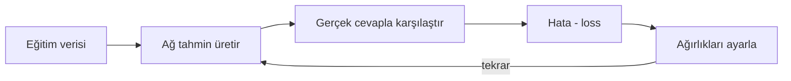

# Yapay Sinir Ağları (ANN)

#derin-öğrenme #yöntemler

## Tanım

**ANN (Artificial Neural Networks)**, beyindeki **biyolojik sinir ağlarını taklit ederek** verideki karmaşık örüntüleri öğrenen bir makine öğrenmesi modelidir.

- **Yapı:** Girdi katmanı → Gizli katmanlar → Çıktı katmanı
- Her nöron bir sonraki katmandaki **tüm** nöronlara bağlıdır (tam bağlantılı).
- **Kullanım alanı:** Finansal öngörü, görüntü tanıma, dil işleme, oyun stratejileri
- **Örnek:** Sesli komut tanıma

| Beyin | ANN |
|---|---|
| Dendrit (sinyal alır) | Girdi ($x$) |
| Sinaps (bağlantı gücü) | Ağırlık ($w$) |
| Hücre gövdesi (karar verir) | Toplama + aktivasyon $f(xw+b)$ |
| Akson (sinyal iletir) | Çıktı |

## Öğrenme

> **Öğrenme = en iyi $w$ (ağırlık) ve $b$ (bias) değerlerini bulmak.**

### 1) Forward Propagation (İleri Yayılım)
Her nöron: $f(xw + b)$ → çıktı bir sonraki katmana girer → en sonda **tahmin ($\hat{y}$)**.

$f$ = aktivasyon fonksiyonu:
- **ReLU:** $\max(0,x)$ → en yaygın, gizli katmanlarda
- **tanh:** çıktı $(-1, 1)$
- **sigmoid:** çıktı $(0, 1)$ → olasılık için

### 2) Loss Calculation (Kayıp Hesaplama)
Tahmin ile gerçek arasındaki fark: $L(\hat{y}, y)$
- **Regresyon** (sayı tahmini) → **MSE**
- **Sınıflandırma** (kategori tahmini) → **Cross-Entropy**

### 3) Backward Propagation (Geri Yayılım)
Hata **çıktıdan girdiye doğru** geri gönderilir. Her ağırlığın hataya katkısı **zincir kuralı** ile bulunur:

$$
\frac{\partial L}{\partial w_1} = \frac{\partial L}{\partial f_2} \cdot \frac{\partial f_2}{\partial f_1} \cdot \frac{\partial f_1}{\partial w_1}
$$

💡 Kesirlerdeki gibi ortadakiler sadeleşiyor gibi düşün: $\partial f_2$ ve $\partial f_1$ gider, geriye $\frac{\partial L}{\partial w_1}$ kalır. Yani "$w_1$ değişirse $f_1$ değişir, $f_1$ değişirse $f_2$ değişir, $f_2$ değişirse $L$ değişir."

### 4) Gradient Descent (Ağırlık Güncelleme)

$$
w = w - \alpha \frac{\partial L}{\partial w}
$$

- $\alpha$ = **learning rate (lr)**: adım büyüklüğü
- Loss grafiği bir **vadi (U)** gibidir. Türev eğimi gösterir. Eğimin **tersine** küçük adımlar atarak vadinin dibine (**minimum loss**) ineriz.
- $\alpha$ çok büyük → dibi atlar ❌ | çok küçük → çok yavaş ❌

### ⚡ Hızlı Tekrar
**Forward** (tahmin et) → **Loss** (hatayı ölç) → **Backward** (suçluyu bul) → **Gradient Descent** (düzelt) → 🔁 tekrar

> Sayılarla adım adım örnek için → [[Derin Öğrenme Kavramı#Derin Öğrenme Nasıl Öğrenir?]]

---
← [[ANN, CNN, RNN, LSTM]] | 🏠 [[Giriş]]
